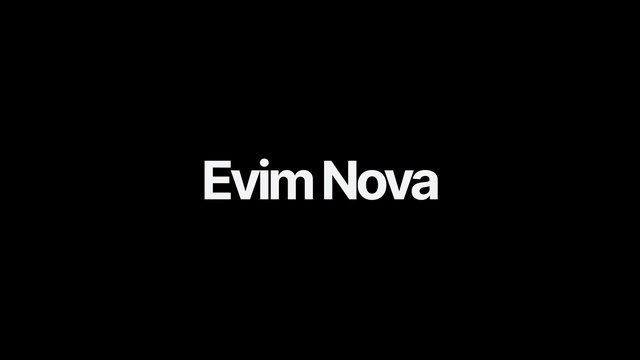
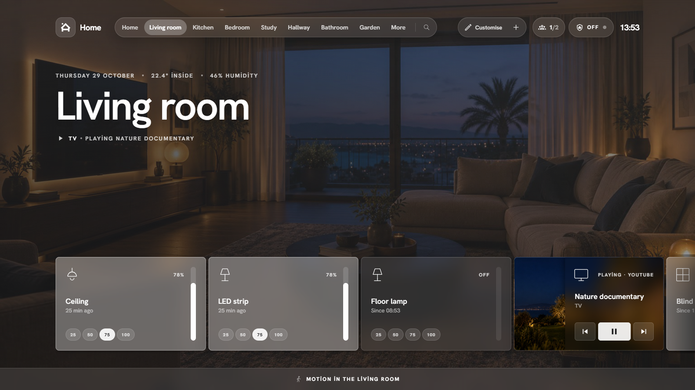
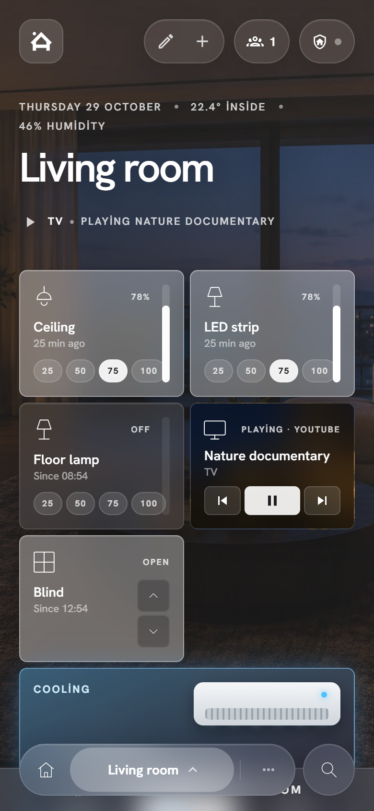

<div align="center">

# Evim Nova

**A room-first, photo-backed home panel for Home Assistant, in Turkish and English.**
With animated boiler and air-conditioner cards, a full-screen alarm screen, 7 themes and wall-tablet support.

[](https://hacs.xyz/docs/faq/custom_repositories/)
[](https://www.home-assistant.io/)
[](LICENSE)

[Türkçe](README.md) · **English**

[Install](#install) · [Guide](docs/guide.md) · [Screenshots](#screenshots) · [Blueprints](#automations-blueprints) · [Promo video](docs/evim-nova-tanitim-en.mp4)



<sub>Full video (1080p, with sound): <a href="docs/evim-nova-tanitim-en.mp4">docs/evim-nova-tanitim-en.mp4</a></sub>

</div>

---

> *Evim* means "my home" in Turkish.

## What's inside

| | |
|---|---|
| 🏠 **Room by room** | Every Home Assistant area becomes a room; its devices show up as cards on their own, over a full-screen photo of the room. |
| 🔥 **Animated boiler** | Flames and rising heat while heating, a pilot flame at target. −/+ for the target, preset button (Eco, Auto…). |
| ❄️ **Animated air conditioner** | For infrared (IR) units: Heat / Cool / Off buttons run scenes, and the last mode is remembered. |
| 🚨 **Alarm screen** | Full-screen countdown, keypad, siren and warning sounds while arming, during the entry delay and when it goes off. |
| 🎨 **7 themes** | Frosted glass, Glow, Night, Sunset, Forest, Neon, Ice. Accent colour, transparency, blur and corner radius. |
| ✏️ **Customise** | Drag cards to reorder, hide them, add new ones. "＋" opens Home Assistant's "Add device" dialog directly. |
| 📱 **Every screen** | Desktop, wall tablet (grid layout, kiosk) and phone (two columns, bottom bar). |
| 🎬 **Scenarios page** | Run your scripts as coloured buttons, turn automations on and off with one tap. |
| 📷 **Camera tab** | Turn the camera system and the camera-driven lights on and off from the panel. |
| 📰 **News and markets** | (Optional) RSS headlines, exchange rates, gold, Bitcoin. |
| 🌐 **Turkish / English** | The language follows your Home Assistant profile. German and Dutch are there too. |

## Screenshots

<table>
<tr><td colspan="2"><br><sub><b>Home view</b>: greeting, weather, quick actions, boiler, air conditioner, media</sub></td></tr>
<tr>
<td width="50%"><br><sub><b>Room page</b>: the room's photo and its device cards</sub></td>
<td width="50%"><br><sub><b>Grid layout</b>: for wall tablets, title on the left, cards on the right</sub></td>
</tr>
<tr>
<td><br><sub><b>Alarm screen</b>: entry delay, countdown, keypad</sub></td>
<td><br><sub><b>Scenarios</b>: one-tap scripts and automations</sub></td>
</tr>
<tr>
<td><br><sub><b>Appearance</b>: theme, accent colour, layout</sub></td>
<td><br><sub><b>Customise</b>: drag, hide, add</sub></td>
</tr>
</table>

<p align="center">
&nbsp;&nbsp;

</p>

**Themes:** Frosted glass · Glow · Night · Sunset · Forest · Neon · Ice

<p align="center">
  
</p>

> The home, devices and people in the screenshots are made up (demo). The room photos are AI-generated examples; feel free to use them from `docs/ornek-odalar/`.

## Install

You need **Home Assistant 2024.4 or newer** and (recommended) **HACS**.
Step by step: **[docs/guide.md](docs/guide.md)**.

### 1. Get the panel

**With HACS (recommended)**
1. Home Assistant → **HACS** → **⋮** top right → **Custom repositories**.
2. Repository: `https://github.com/turkerkirgin/evim-nova`, type: **Dashboard**. **Add**.
3. Search HACS for **Evim Nova** → **Download**. Reload the browser.

**Manually**
1. Download `evim-nova.js` from the [latest release](https://github.com/turkerkirgin/evim-nova/releases/latest) or from `dist/`.
2. Copy it to `/config/www/evim-nova/evim-nova.js`.
3. **Settings → Dashboards → ⋮ → Resources → Add resource**: `/local/evim-nova/evim-nova.js`, type *JavaScript module*.

### 2. Create the dashboard

1. **Settings → Dashboards → Add dashboard → New dashboard from scratch**, name it "Evim Nova".
2. Open it → ✏️ → **⋮ → Raw configuration editor**.
3. Paste [`examples/evim-nova-dashboard.yaml`](examples/evim-nova-dashboard.yaml). Replace the entity ids with your own devices (or delete the parts you don't know; the panel finds the rest).
4. Save. From now on most things are set inside the panel: **More → Panel settings**.

The shortest version is one line; the panel finds everything by itself:

```yaml
type: custom:evim-nova-card
```

> The view type must be **Panel (single card)**. The example YAML already sets it.

### 3. Room photos

Put photos in `/config/www/images/rooms/` (`living-room.jpg`, `kitchen.jpg` …; `home.jpg` for the home view). The panel matches them to the area names. Ready-made examples: [`docs/ornek-odalar/`](docs/ornek-odalar).

### 4. Alarm, camera and the rest (optional)

| What | File | Where |
|---|---|---|
| Alarm panel + helpers | [`homeassistant/packages/evim_nova.yaml`](homeassistant/packages/evim_nova.yaml) | `/config/packages/` |
| Alarm sounds | [`homeassistant/www/sesler/`](homeassistant/www/sesler) | `/config/www/sesler/` |
| News and markets | [`homeassistant/packages/evim_bilgi.yaml`](homeassistant/packages/evim_bilgi.yaml) | `/config/packages/` |
| Blueprints | [`homeassistant/blueprints/automation/evim_nova/`](homeassistant/blueprints/automation/evim_nova) | `/config/blueprints/automation/evim_nova/` |

Packages must be enabled in `configuration.yaml`:

```yaml
homeassistant:
  packages: !include_dir_named packages
```

The alarm code goes in `secrets.yaml`: `evim_alarm_kodu: "1234"`.

## Automations (blueprints)

| Blueprint | What it does |
|---|---|
| **Alarm: trigger from sensors** | While armed, a door, window or motion sensor sets off the alarm and the reason shows on screen. |
| **Alarm: notify and lights** | Critical phone notification (camera image, "Disarm" button) and flashing lights when the alarm goes off. |
| **Wake the wall tablet** | Turns the Android tablet's screen on when a door opens or during an alarm. |
| **Track an IR air conditioner** | Remembers the last mode when an AC scene runs; the animated AC card shows it. |
| **Camera direction light (Frigate)** | Turns a light on when the camera sees someone walk from zone A to zone B. |

Install: copy the files to `/config/blueprints/automation/evim_nova/`, reload **Settings → Automations → Blueprints**, then **Create automation** for each and pick your own devices.

## Updating

With HACS, a new version shows up in the notification row on the home view. Tap it and press **Install**. Settings are stored in Home Assistant, so updates never touch them.

## Development

```bash
npm install
npm run build          # dist/evim-nova.js
python -m http.server 8097
# http://127.0.0.1:8097/dev/demo.html?lang=en#/salon   (a made-up demo home; ?tema=neon, ?alarm=pending)
python dev/shots.py    # README screenshots (Playwright + Edge)
python video/render.py # promo video (Playwright + ffmpeg)
```

More in [CONTRIBUTING.md](CONTRIBUTING.md).

## Credits and license

Evim Nova is built on **[HaCasa Nova](https://github.com/damianeickhoff/HaCasa)** by Damian Eickhoff, whose look is based on **[Homio](https://github.com/iamtherufus/Homio)** by iamtherufus. Both are MIT-licensed. For the base panel's features (cards, settings, groups, graphs) see the HaCasa Nova [documentation](https://damianeickhoff.github.io/HaCasa/) as well.

This project is released under the [MIT license](LICENSE) too. See [NOTICE.md](NOTICE.md).
