<div align="center">

# Evim Nova

**Home Assistant için oda odaklı, fotoğraflı, Türkçe bir ev paneli.**
Animasyonlu kombi ve klima kartları, tam ekran alarm ekranı, 7 tema ve duvar tableti desteğiyle.

[](https://hacs.xyz/docs/faq/custom_repositories/)
[](https://www.home-assistant.io/)
[](LICENSE)

**Türkçe** · [English](README.en.md)

[Kurulum](#kurulum) · [Eğitim rehberi](docs/rehber.md) · [Ekran görüntüleri](#ekran-görüntüleri) · [Blueprint'ler](#otomasyonlar-blueprintler) · [Tanıtım videosu](docs/evim-nova-tanitim-tr.mp4)

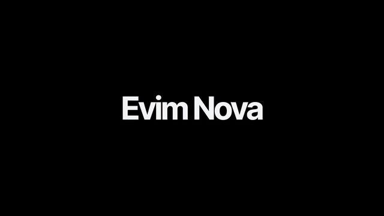

<sub>Videonun tamamı (1080p, sesli): <a href="docs/evim-nova-tanitim-tr.mp4">docs/evim-nova-tanitim-tr.mp4</a></sub>

</div>

---

## Neler var?

| | |
|---|---|
| 🏠 **Oda oda panel** | Home Assistant'taki her alan bir oda olur; cihazlar kendiliğinden kart olarak gelir. Her odanın kendi fotoğrafı arkada durur. |
| 🔥 **Animasyonlu kombi** | Isıtırken alev ve sıcak hava, hedefteyken pilot alevi. −/+ ile hedef sıcaklık, ön ayar (Eko, Otomatik…). |
| ❄️ **Animasyonlu klima** | Kızılötesi (IR) klimalar için: Isıt / Soğut / Kapat düğmeleri sahneleri çalıştırır, son mod hatırlanır. |
| 🚨 **Alarm ekranı** | Alarm kurulurken, giriş süresinde ve çalarken tam ekran geri sayım, şifre tuşları, siren ve uyarı sesleri. |
| 🎨 **7 tema** | Buzlu cam, Işıma, Gece, Gün batımı, Orman, Neon, Buz. Vurgu rengi, saydamlık, bulanıklık ve köşe ayarı. |
| ✏️ **Özelleştir** | Kartları sürükleyip sırala, gizle, yenisini ekle. "＋" ile doğrudan Home Assistant'ın "Cihaz ekle" penceresi. |
| 📱 **Her ekranda** | Bilgisayar, duvar tableti (ızgara düzeni, kiosk) ve telefon (iki sütun, alt menü). |
| 🎬 **Senaryolar sayfası** | Script'lerini renkli düğmeler olarak çalıştır, otomasyonları tek dokunuşla aç/kapat. |
| 📷 **Kamera sekmesi** | Kamera sistemini ve kameraya göre yanan ışıkları panelden aç/kapat. |
| 📰 **Haberler ve piyasalar** | (İsteğe bağlı) RSS haberleri, dolar, euro, altın, Bitcoin. |
| 🌐 **Türkçe / İngilizce** | Dil, Home Assistant profilinden gelir. Almanca ve Felemenkçe de var. |

## Ekran görüntüleri

<table>
<tr><td colspan="2">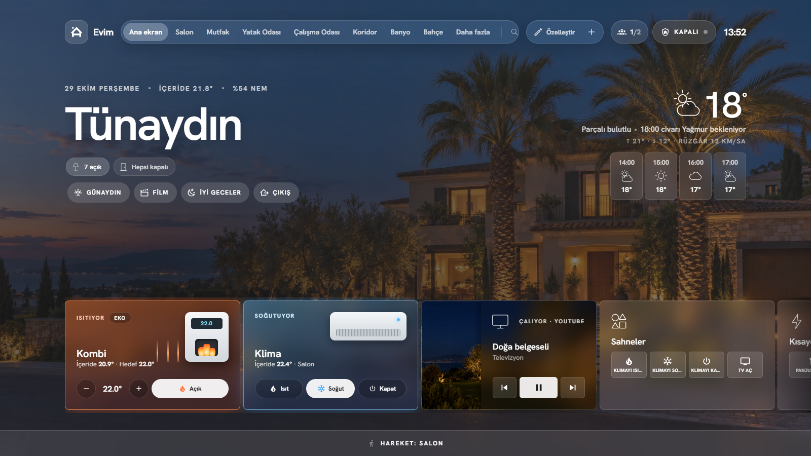<br><sub><b>Ana ekran</b>: selamlama, hava durumu, hızlı düğmeler, kombi, klima, medya</sub></td></tr>
<tr>
<td width="50%">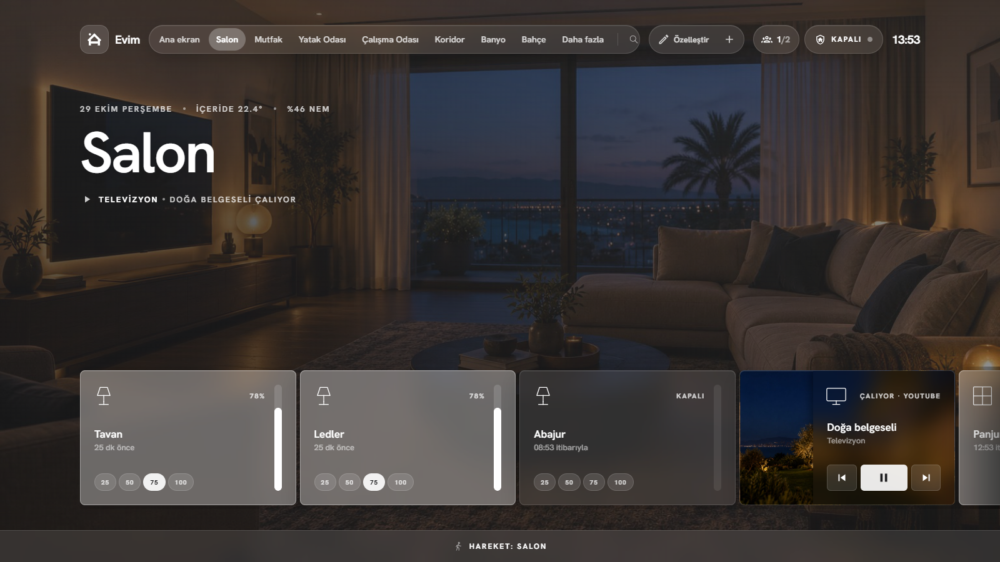<br><sub><b>Oda sayfası</b>: odanın fotoğrafı ve cihaz kartları</sub></td>
<td width="50%">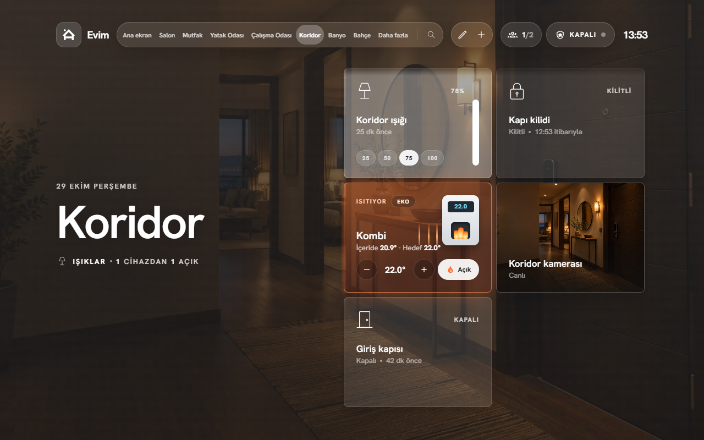<br><sub><b>Izgara düzeni</b>: duvar tableti için başlık solda, kartlar sağda</sub></td>
</tr>
<tr>
<td>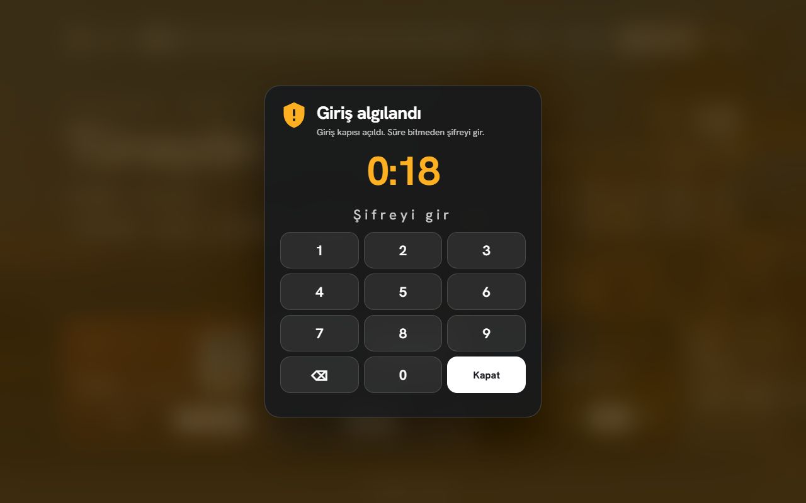<br><sub><b>Alarm ekranı</b>: giriş süresi, geri sayım, şifre tuşları</sub></td>
<td>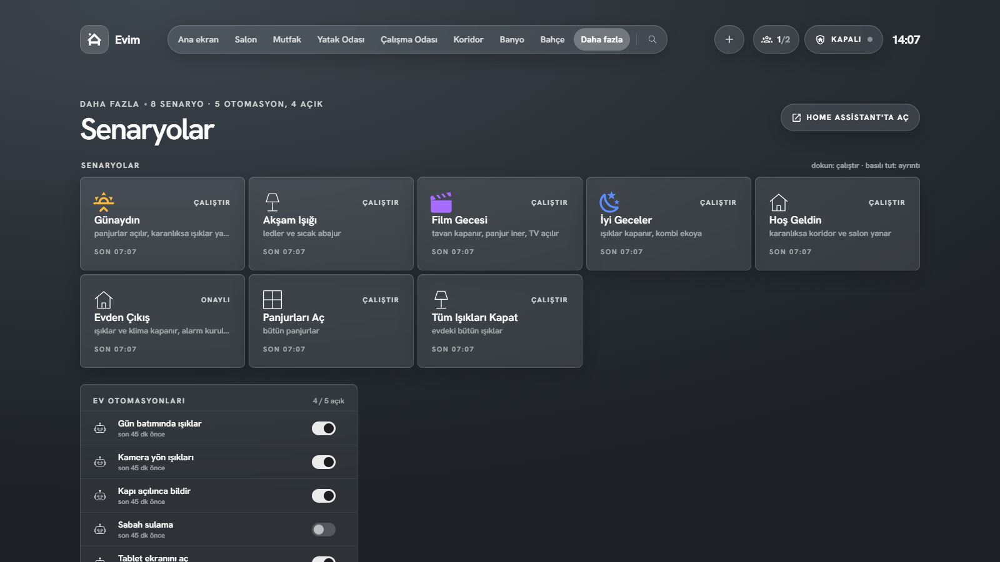<br><sub><b>Senaryolar</b>: tek dokunuşla çalışan script'ler ve otomasyonlar</sub></td>
</tr>
<tr>
<td>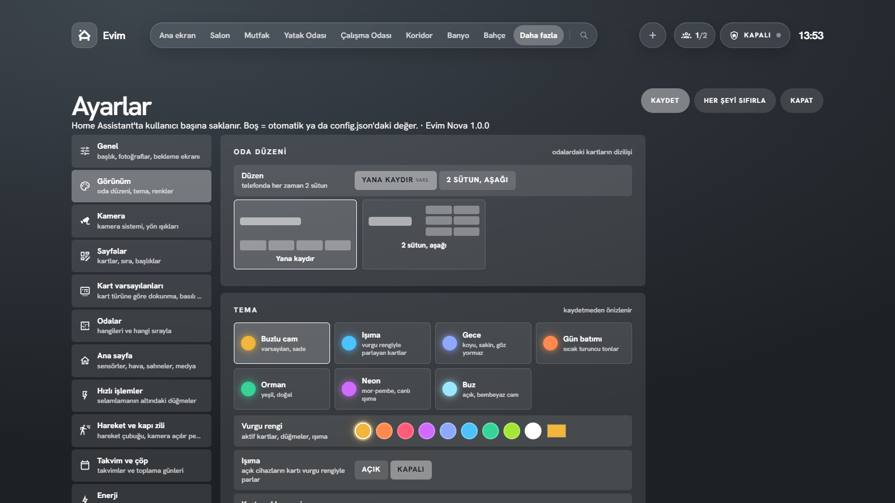<br><sub><b>Görünüm</b>: tema, vurgu rengi, düzen</sub></td>
<td>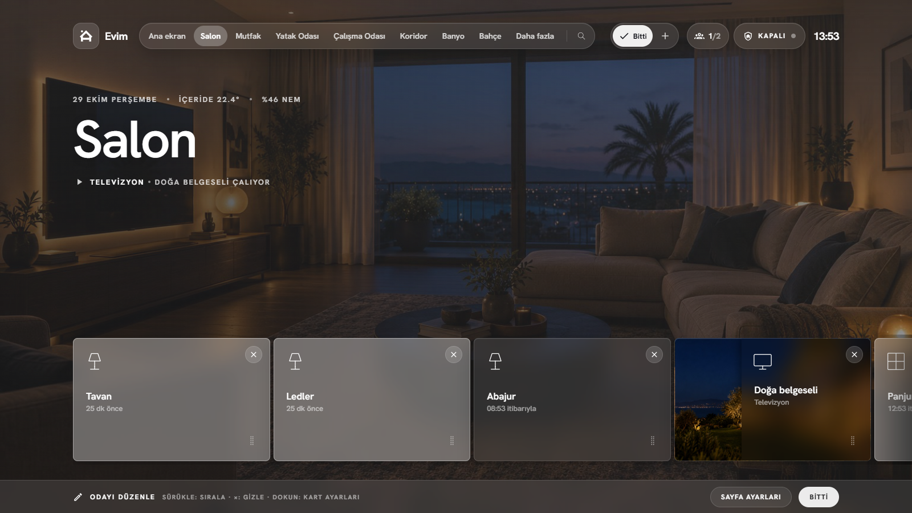<br><sub><b>Özelleştir</b>: sürükle, gizle, ekle</sub></td>
</tr>
</table>

<p align="center">
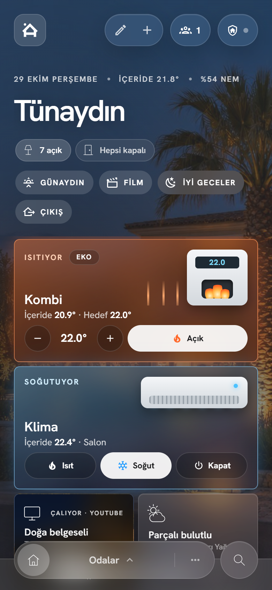&nbsp;&nbsp;
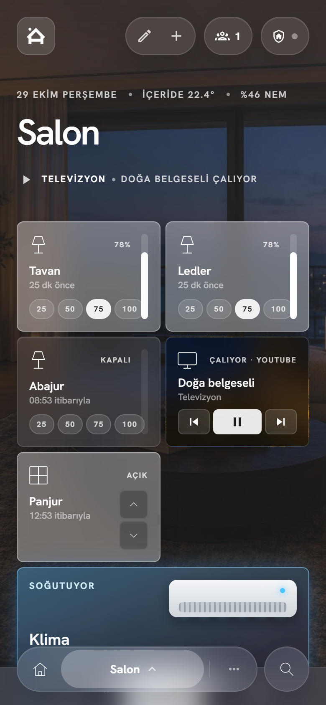
</p>

**Temalar:** Buzlu cam · Işıma · Gece · Gün batımı · Orman · Neon · Buz

<p align="center">
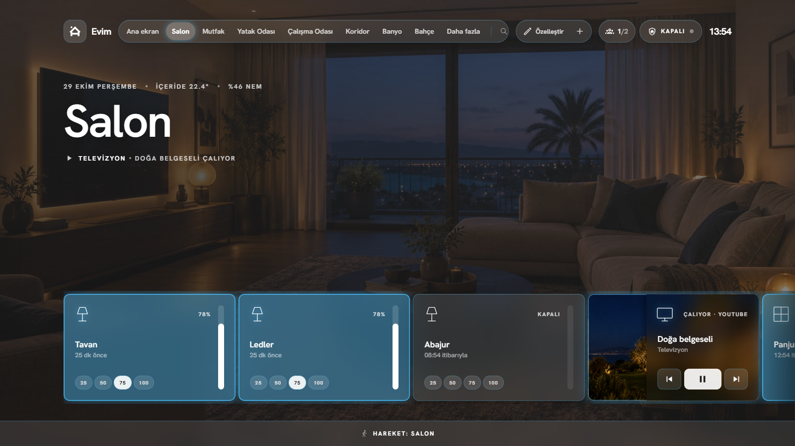 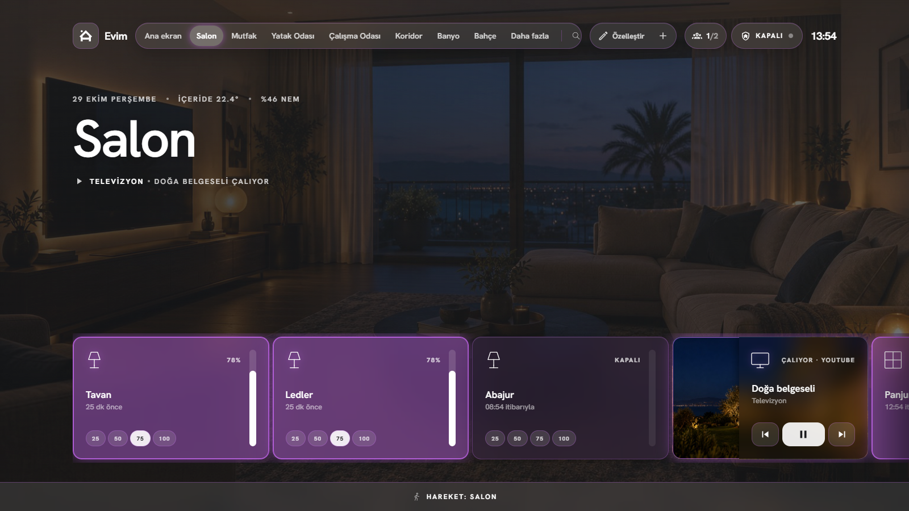 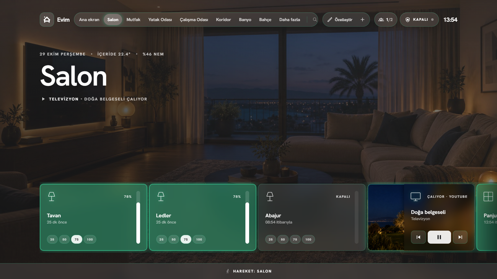
</p>

> Görüntülerdeki ev, cihazlar ve kişiler tamamen uydurmadır (demo). Oda fotoğrafları yapay zekâyla üretilmiş örneklerdir; `docs/ornek-odalar/` klasöründen sen de kullanabilirsin.

## Kurulum

Gerekenler: **Home Assistant 2024.4 veya daha yeni** ve (önerilir) **HACS**.
Adım adım anlatım: **[docs/rehber.md](docs/rehber.md)**.

### 1. Paneli indir

**HACS ile (önerilen)**
1. Home Assistant → **HACS** → sağ üstte **⋮** → **Özel depolar (Custom repositories)**.
2. Depo: `https://github.com/turkerkirgin/evim-nova`, tür: **Dashboard**. **Ekle**.
3. HACS'ta **Evim Nova**'yı ara → **İndir**. Tarayıcıyı yenile.

**Elle**
1. [Son sürümden](https://github.com/turkerkirgin/evim-nova/releases/latest) ya da `dist/` klasöründen `evim-nova.js` dosyasını indir.
2. `/config/www/evim-nova/evim-nova.js` olarak kopyala.
3. **Ayarlar → Panolar → ⋮ → Kaynaklar → Kaynak ekle**: `/local/evim-nova/evim-nova.js`, tür *JavaScript modülü*.

### 2. Panoyu oluştur

1. **Ayarlar → Panolar → Pano ekle → Sıfırdan yeni pano**, adı "Evim Nova".
2. Panoyu aç → ✏️ → **⋮ → Ham yapılandırma düzenleyicisi**.
3. [`examples/evim-nova-dashboard.yaml`](examples/evim-nova-dashboard.yaml) dosyasının içeriğini yapıştır. Varlık adlarını kendi cihazlarınla değiştir (ya da bilmediğin bölümleri sil, panel geri kalanını kendisi bulur).
4. Kaydet. Panel açılır. Ayarların çoğunu bundan sonra panelin içinden yapabilirsin: **Daha fazla → Panel ayarları**.

En kısa hâli tek satırdır, panel her şeyi kendisi bulur:

```yaml
type: custom:evim-nova-card
```

> Görünüm türü **Panel (tek kart)** olmalı. Örnek YAML bunu zaten ayarlıyor.

### 3. Oda fotoğrafları

Fotoğrafları `/config/www/images/rooms/` klasörüne koy (`salon.jpg`, `mutfak.jpg` …; ana ekran için `home.jpg`). Panel, alan adına göre dosyayı kendisi bulur. Hazır örnekler: [`docs/ornek-odalar/`](docs/ornek-odalar).

### 4. Alarm, kamera ve diğerleri (isteğe bağlı)

| Ne | Dosya | Nereye |
|---|---|---|
| Alarm paneli + yardımcılar | [`homeassistant/packages/evim_nova.yaml`](homeassistant/packages/evim_nova.yaml) | `/config/packages/` |
| Alarm sesleri | [`homeassistant/www/sesler/`](homeassistant/www/sesler) | `/config/www/sesler/` |
| Haberler ve piyasalar | [`homeassistant/packages/evim_bilgi.yaml`](homeassistant/packages/evim_bilgi.yaml) | `/config/packages/` |
| Blueprint'ler | [`homeassistant/blueprints/automation/evim_nova/`](homeassistant/blueprints/automation/evim_nova) | `/config/blueprints/automation/evim_nova/` |

`configuration.yaml` dosyasında paketler açık olmalı:

```yaml
homeassistant:
  packages: !include_dir_named packages
```

Alarm şifresi `secrets.yaml` dosyasına yazılır: `evim_alarm_kodu: "1234"`.

## Otomasyonlar (blueprint'ler)

| Blueprint | Ne yapar |
|---|---|
| **Alarm: sensörle tetikle** | Alarm kuruluyken kapı, pencere ya da hareket sensörü açılınca alarmı çaldırır, sebebini ekrana yazar. |
| **Alarm: bildirim ve ışıklar** | Alarm çalınca telefona kritik bildirim (kamera görüntüsü, "Alarmı kapat" düğmesi), ışıkları yakıp söndürür. |
| **Duvar tableti ekranını aç** | Kapı açılınca ya da alarm sırasında Android tabletin ekranını uyandırır. |
| **IR klima modunu takip et** | Klima sahnesi çalışınca son modu hatırlar; animasyonlu klima kartı bunu gösterir. |
| **Kamera yön ışığı (Frigate)** | Kamera kişinin A bölgesinden B bölgesine yürüdüğünü görünce ışığı yakar. |

Kurulum: dosyaları `/config/blueprints/automation/evim_nova/` klasörüne kopyala, **Ayarlar → Otomasyonlar → Blueprint'ler**'i yenile. Her biri için **Otomasyon oluştur** de ve kendi cihazlarını seç.

## Güncelleme

HACS kullanıyorsan yeni sürüm çıkınca ana ekranın bildirim satırında görünür. Dokun ve **Yükle**'ye bas. Ayarların Home Assistant'ta saklandığı için güncellemeler onlara dokunmaz.

## Geliştirme

```bash
npm install
npm run build          # dist/evim-nova.js
python -m http.server 8097
# http://127.0.0.1:8097/dev/demo.html#/salon   (uydurma bir evle demo; ?lang=en, ?tema=neon, ?alarm=pending)
python dev/shots.py    # README ekran görüntüleri (Playwright + Edge)
python video/render.py # tanıtım videosu (Playwright + ffmpeg)
```

Ayrıntılar: [CONTRIBUTING.md](CONTRIBUTING.md).

## Teşekkür ve lisans

Evim Nova, Damian Eickhoff'un **[HaCasa Nova](https://github.com/damianeickhoff/HaCasa)** projesi üzerine kuruludur. HaCasa Nova'nın tasarımı da iamtherufus'un **[Homio](https://github.com/iamtherufus/Homio)** projesine dayanır. İkisi de MIT lisanslıdır. Temel panelin özellikleri (kartlar, ayarlar, gruplar, grafikler) için HaCasa Nova'nın [belgelerine](https://damianeickhoff.github.io/HaCasa/) de bakabilirsin.

Bu proje de [MIT lisansı](LICENSE) ile dağıtılır. Ayrıntılar: [NOTICE.md](NOTICE.md).
