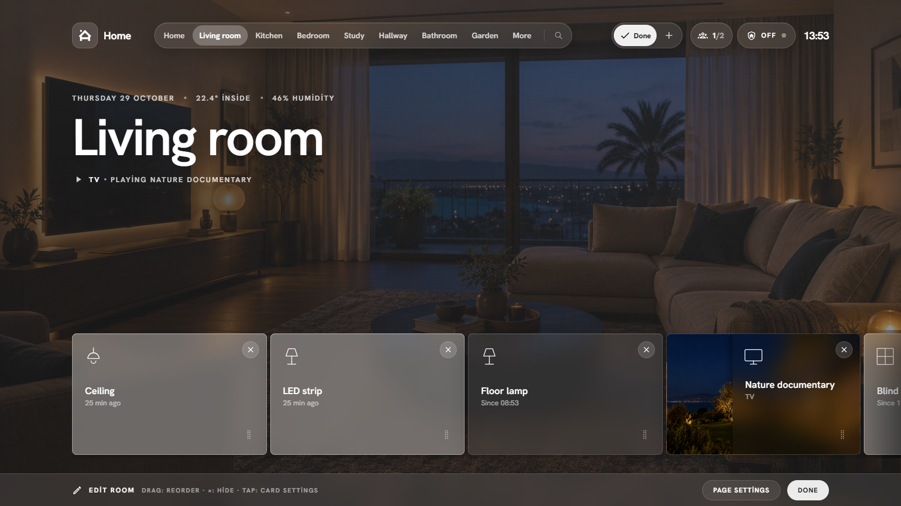
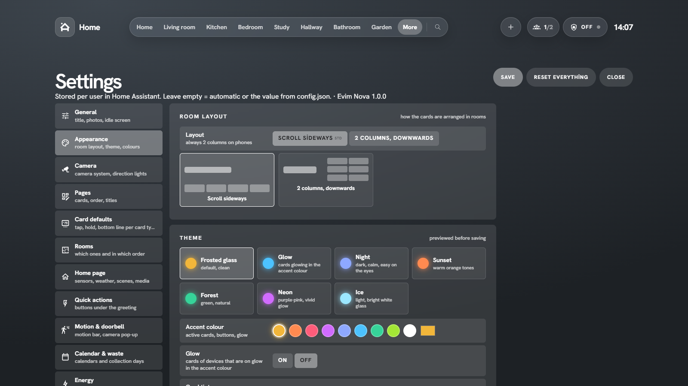
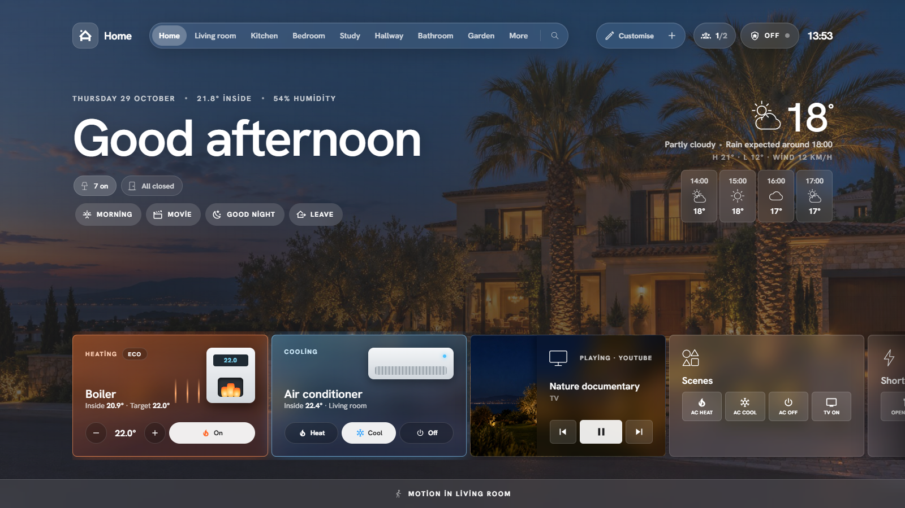
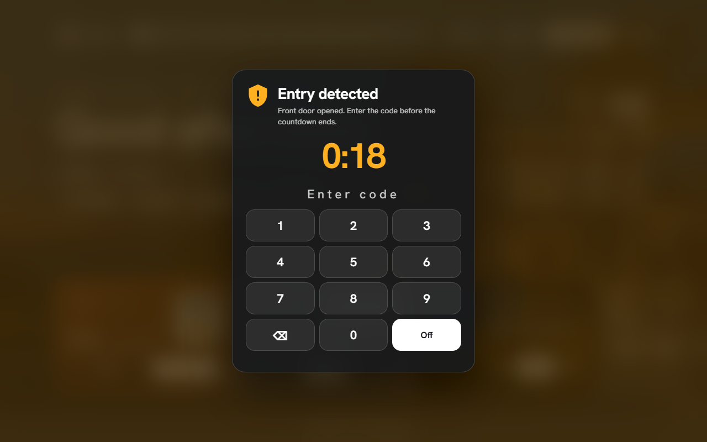
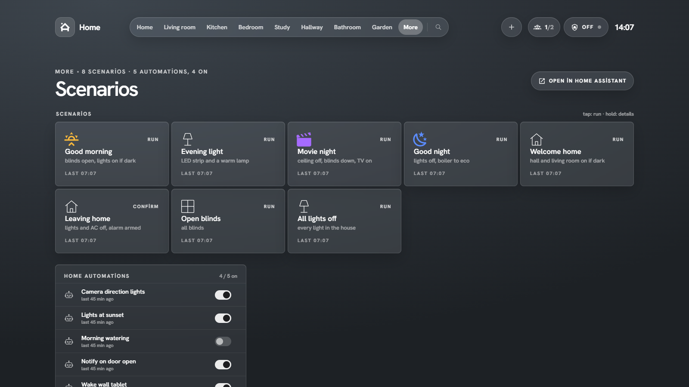
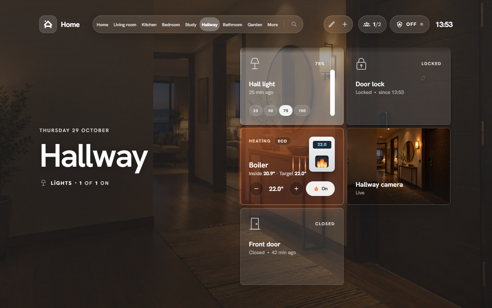
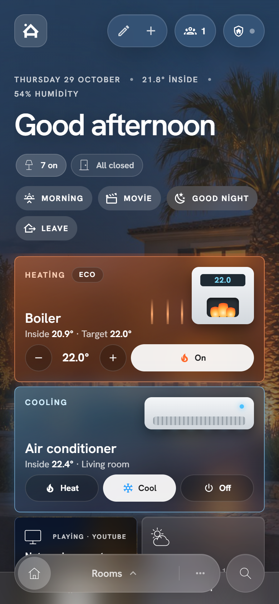

# Evim Nova · User guide

[Türkçe](rehber.md) · **English**

This guide walks you through installing Evim Nova from scratch and using it day to day. It works even if your Home Assistant is brand new; all you need is to open Home Assistant in a browser.

**Contents**

1. [Before you start](#1-before-you-start)
2. [Install the panel](#2-install-the-panel)
3. [Create the dashboard](#3-create-the-dashboard)
4. [Rooms and photos](#4-rooms-and-photos)
5. [Adding devices](#5-adding-devices)
6. [Using the cards](#6-using-the-cards)
7. [Customise: reorder, hide, add](#7-customise-reorder-hide-add)
8. [Appearance and themes](#8-appearance-and-themes)
9. [Home view](#9-home-view)
10. [Boiler and air-conditioner cards](#10-boiler-and-air-conditioner-cards)
11. [Alarm](#11-alarm)
12. [Camera and direction lights](#12-camera-and-direction-lights)
13. [Scenarios page](#13-scenarios-page)
14. [Wall tablet](#14-wall-tablet)
15. [On your phone](#15-on-your-phone)
16. [News and markets](#16-news-and-markets)
17. [Back up and move your settings](#17-back-up-and-move-your-settings)
18. [FAQ and troubleshooting](#18-faq-and-troubleshooting)

---

## 1. Before you start

- **Home Assistant 2024.4 or newer.** Check under **Settings → About**.
- **HACS** (recommended), the community store for Home Assistant: [hacs.xyz](https://hacs.xyz/docs/use/). A manual install works too.
- **Areas (rooms).** Evim Nova builds its rooms from Home Assistant **areas**. Make sure you have areas such as Living room, Kitchen, Bedroom under **Settings → Areas, labels & zones**.
- **File access.** Photos and sounds go into `/config/www/`. The easiest way is the **File editor** or **Studio Code Server** add-on, or **Samba** from your computer.

> Files in `/config/www/` are served under `/local/`: `/config/www/images/rooms/kitchen.jpg` = `/local/images/rooms/kitchen.jpg`.

## 2. Install the panel

### With HACS (recommended)

1. Open **HACS** from the sidebar.
2. **⋮** top right → **Custom repositories**.
3. Repository `https://github.com/turkerkirgin/evim-nova`, type **Dashboard**, **Add**.
4. Search HACS for **Evim Nova**, open it, **Download**.
5. Reload the browser when HACS asks.

HACS downloads the file, adds it as a dashboard resource and tells you when a new version is out.

### Manually

1. Download `evim-nova.js` from the [latest release](https://github.com/turkerkirgin/evim-nova/releases/latest) (or from `dist/` in the repository).
2. Create `/config/www/evim-nova/` and put the file in it.
3. **Settings → Dashboards → ⋮ (top right) → Resources → Add resource**.
   - URL: `/local/evim-nova/evim-nova.js`
   - Type: **JavaScript module**
4. Reload the browser (Ctrl+F5).

> No **Resources** menu? Turn on **Advanced mode** in your profile (your name, bottom left).

## 3. Create the dashboard

Evim Nova runs as a dashboard card that fills the whole screen.

1. **Settings → Dashboards → Add dashboard → New dashboard from scratch**.
2. Name `Evim Nova`, icon `mdi:home-heart`. **Create**.
3. Open it from the sidebar. ✏️ (edit) top right → **⋮** → **Raw configuration editor**.
4. Replace everything with the contents of [`examples/evim-nova-dashboard.yaml`](../examples/evim-nova-dashboard.yaml).
5. **Save**, then **Done**.

The example uses made-up entity ids (`climate.kombi`, `alarm_control_panel.ev_alarmi` …). Two ways to go:

- **Quick start:** delete everything under `config:` and keep only `type: custom:evim-nova-card`. The panel finds rooms, weather, thermostat and alarm by itself. A short setup wizard appears on first open; after that you set everything inside the panel.
- **Detailed:** replace the entity ids with your own. Find an entity's id under **Settings → Devices & services → Entities**; it looks like `light.living_room_ceiling`.

> Settings made inside the panel (More → Panel settings) are stored **per user** in Home Assistant. The YAML is the starting point for everyone.

## 4. Rooms and photos

### Rooms

Every Home Assistant area becomes a room, and every device assigned to it shows up as a card.

- **Order** and which rooms are shown: **More → Panel settings → Rooms**.
- Room **name**: the area's name; change it under **Settings → Areas**.
- Move a device to another room: change its **area** on the device page.

### Photos

Photos are what make the panel feel like your home. For each room the panel looks, in order, for:

1. A photo picked for that room in the panel (**hold** the room title, or **Panel settings → Pages**).
2. The **area picture** in Home Assistant (Settings → Areas → area → picture).
3. A file in `/config/www/images/rooms/` named after the area: `Living room` → `living-room.jpg` (`.jpeg`, `.png`, `.webp` work too).
4. Nothing found: a calm gradient.

The home view uses `home.jpg`, or **Panel settings → General → Home page photo**.

**Tips**
- Landscape photos 1600–2400 px wide work best.
- Evening shots with the lights on look great behind the glass cards.
- Want to try it right away? Use the examples in [`docs/ornek-odalar/`](ornek-odalar).

## 5. Adding devices

Evim Nova does not add devices itself; every device you add to Home Assistant appears in the panel on its own.

1. Press **＋** in the panel's top bar. Home Assistant's **Add device** dialog opens (the **← Home** button bottom left takes you back).
2. Pick the brand and add the device (Tuya, Sonoff, Philips Hue, Zigbee…).
3. If it asks for an **area**, pick the room. Otherwise set the area on the device page later.
4. Back in the panel, the device is a card on that room's page.

A device without an area can be placed by hand: **✏️ Customise → Add card → Devices**.

## 6. Using the cards

| Gesture | What happens |
|---|---|
| **Tap** | Toggle (light, plug, switch), open/close a blind, run a scene |
| **Hold** | Details: brightness, colour, temperature, history, settings |
| **25 / 50 / 75 / 100** (under a light card) | Sets the brightness right away |
| **⋯** (in the popup) | Card settings, open in Home Assistant, open device, hide on this page |

Change tap and hold per card type under **Panel settings → Card defaults**, or per card through **⋯ → Card settings** in its popup.

## 7. Customise: reorder, hide, add



1. Press **✏️ Customise** in the top bar (or hold the page title).
2. **Drag** a card to move it.
3. **×** hides a card. Hidden cards stay dimmed; the eye icon brings them back.
4. **Add card** at the end of the row: a device, group, graph, weather, calendar, template card…
5. **Tap** a card for its settings (name, icon, visibility condition…).
6. **Done** to leave.

In the **grid layout** (see section 8), **←** on a card moves it under the title, **→** back to the right.

For the **Scenes** and **Shortcuts** cards, pick which buttons appear under **Content** in the card settings (5 at most, in order).

## 8. Appearance and themes



**More → Panel settings → Appearance**

- **Room layout**
  - *Scroll sideways*: cards in a horizontal row at the bottom (desktop).
  - *2 columns, downwards*: title on the left, cards flowing down on the right (wall tablet).
  - Phones always use 2 columns.
- **Theme**: Frosted glass, Glow, Night, Sunset, Forest, Neon, Ice.
- **Accent colour**, **glow**, **card tint**, **transparency**, **blur**, **corner radius**, **photo dimming**.

Changes preview before you save. **Save** applies them.

## 9. Home view



- **Greeting and date**, average indoor temperature and humidity.
- **Status pills**: lights on, open doors and windows. Tap for the list.
- **Quick actions** (buttons under the greeting): **Panel settings → Quick actions**. A script, a scene or "all lights off", optionally with a confirmation.
- **Weather**: tap for the hourly and daily forecast.
- **Cards**: boiler, air conditioner, media, scenes, shortcuts, markets… chosen under **Panel settings → Home page**.
- Top right: people at home, **alarm** state (tap to arm/disarm), clock.

## 10. Boiler and air-conditioner cards

### Boiler (a real thermostat)

If your boiler is a `climate` entity in Home Assistant (Tuya, Netatmo, Ariston, Baxi… thermostats), add to the dashboard:

```yaml
kombi: { ad: Boiler, entity: climate.boiler, oda: hallway }
cards:
  climate.boiler: { hidden: true }   # instead of the plain thermostat card in the room
```

The card shows **heating** (flames and rising heat) or **at target** (pilot flame). Boilers do not report "burning right now", so the rule is: on and the room below target means heating. **−/+** changes the target by 0.5°, the right button turns it on/off, the small button on top cycles the presets.

### Air conditioner (infrared)

IR units do not report their state, so:

1. With your IR blaster (Tuya IR, Broadlink…) make three scenes or scripts: **heat**, **cool**, **off**.
2. Add the `input_select.klima_modu` helper from `homeassistant/packages/evim_nova.yaml` (its options can be `Off, Heat, Cool`).
3. Create an automation from the **Track an IR air conditioner** blueprint: pick the three scenes and the helper.
4. Add to the dashboard:

```yaml
klima:
  ad: Air conditioner
  oda: living_room
  oda_adi: Living room
  mod: input_select.klima_modu
  sicaklik: sensor.living_room_temperature
  isit: scene.ac_heat
  sogut: scene.ac_cool
  kapat: scene.ac_off
```

The card glows orange with rising heat while heating and blue with snowflakes while cooling.

> If you use the remote or the Tuya app, Home Assistant cannot know; the card keeps the last mode it saw.

## 11. Alarm



The alarm screen works with any Home Assistant alarm panel. For the ready-made setup:

1. Put `homeassistant/packages/evim_nova.yaml` in `/config/packages/`.
2. Add your code to `secrets.yaml`: `evim_alarm_kodu: "1234"`.
3. Copy `homeassistant/www/sesler/` to `/config/www/sesler/` (siren, warning and arming sounds).
4. Restart Home Assistant. `alarm_control_panel.ev_alarmi` appears.
5. Create an automation from **Alarm: trigger from sensors**: pick your door and motion sensors.
6. Optionally add **Alarm: notify and lights** for a phone notification and flashing lights.
7. In the dashboard set `home.alarm: alarm_control_panel.ev_alarmi` and `alarm: { cikis: 120, giris: 35 }` (the same as `arming_time` and `delay_time` in the package).

**Using it**

- Tap the **shield** top right → **Away** (or Home, Night).
- **Arming**: a 2-minute countdown and "You can leave now". **Hide** closes it.
- **Entry detected**: a 35-second countdown and a keypad when the door opens. Enter the code, **Off**.
- **ALARM**: the screen flashes red and the siren sounds until the code is entered.
- **Sound**: siren and warning are switched per device (alarm popup → *Alarm sound on this device*). Off by default on phones. Check with **Test sound**.
- **Test**: arm in *Custom bypass* (`armed_custom_bypass`) and trigger it: it sounds for 15 seconds and stops.

> Browsers only play sound after a tap. On a wall tablet one tap on the screen is enough. With Fully Kiosk Browser, turn on **Web Content Settings → Autoplay Videos**.

## 12. Camera and direction lights

**Panel settings → Camera** has two switches (helpers from the package):

- **Camera system** (`input_boolean.kamera_sistemi`): use it as a condition in your own automations (e.g. stop Frigate and the stream while it is off).
- **Camera lights** (`input_boolean.kamera_isiklari`): turns the direction lights on/off. Turn it off when you have guests.

**Direction lights (Frigate)**

1. Install [Frigate](https://frigate.video) and connect it to Home Assistant over MQTT.
2. Draw **zones** on the camera, e.g. `hall`, `bedroom_door`, `kitchen_path`.
3. Create one automation per direction from **Camera direction light (Frigate)**: "from hall to bedroom_door → turn on the bedroom ceiling light". There are time-window and "only when dark" options.

To show the camera and people count in the status line, add:

```yaml
kamera:
  durum: { kamera: camera.hallway, kisi: sensor.hallway_person_count }
```

To pop up a camera when a door opens: **Panel settings → Motion & doorbell** → camera, triggers and duration.

## 13. Scenarios page



**More → Scenarios** shows your scripts as coloured buttons. Tap: run, hold: details. Add `confirm` to anything risky so it asks first:

```yaml
scenarios:
  - { entity: script.leaving_home, label: Leaving home, sub: everything off, icon: mdi:home-export-outline, color: "#ff5c7a", confirm: "Are you sure?" }
```

Automations are listed below with a switch each. Automations whose name starts with `Evim ·` get their own **Home automations** block (change it with `scenarioPrefix`).

## 14. Wall tablet



Recommended setup (Android tablet):

1. Install the **Home Assistant** app on the tablet and log in.
2. Open the Evim Nova dashboard and pick **Appearance → 2 columns, downwards**.
3. For full screen: install **kiosk-mode** from HACS and add `kiosk_mode: { kiosk: true }` to the dashboard; give the Evim Nova card `full_height: true`. To show the menus for a moment: **More → Show menus**.
4. In Android settings use a short screen timeout (e.g. 1 min) and screen lock **None**.
5. Use the **Wake the wall tablet** blueprint so the screen turns on when a door opens or during an alarm. Motion does not wake it, which saves battery and screen.
6. On Samsung, keep the app alive: battery → **Unrestricted**, and add it to "Never sleeping apps".

## 15. On your phone



Cards use two columns on phones. The bottom bar has **home**, **rooms**, **more** and **search**. Swipe left and right to move between rooms. To open the Home Assistant app on Evim Nova, pick it as your **Dashboard** in your profile (your name, bottom left).

## 16. News and markets

Optional. Put `homeassistant/packages/evim_bilgi.yaml` in `/config/packages/` and restart. It fetches BBC Türkçe, Euronews and BBC World headlines and USD, EUR, GBP, gold, BIST 100 and Bitcoin from Yahoo Finance every 15 minutes (no API key). The `piyasa:` and `haberler:` sections in the dashboard turn on the card and the page. For your own RSS feed, copy a block in the package and change its address.

## 17. Back up and move your settings

**Panel settings → General → Settings file**
- **Export** downloads all your panel settings as a JSON file.
- **Import** sets up the same layout for another user or another Home Assistant.

Every user has their own settings, so everyone at home can arrange the panel their way.

## 18. FAQ and troubleshooting

**"Custom element doesn't exist: evim-nova-card"**
The resource is missing or the browser cached an old file. Check that HACS downloaded it or that the resource is added, then reload with **Ctrl+F5**. In the Home Assistant app: **Settings → Companion app → Troubleshooting → Reset frontend cache**.

**The panel is small or has margins**
The view type must be **Panel (single card)**. Edit the dashboard → pencil on the view → View type.

**A device is missing**
It needs an area. Entities of the *diagnostic* or *config* category (except batteries) are left out on purpose. You can still add it with **Customise → Add card**.

**A room photo does not show**
The file name is the area name in lower case with hyphens: `Living room` → `living-room.jpg`. After replacing a photo, reload (the panel caches photos for an hour).

**No alarm sound**
Tap the screen once (a browser rule). Check *Alarm sound on this device* in the alarm popup. Make sure the files are in `/config/www/sesler/` (`/local/sesler/siren.wav` should open in the browser).

**Wrong language**
The panel follows your Home Assistant profile. Override it under **Panel settings → General → Language** or with `language: en` in the dashboard.

**The AC card shows the wrong mode**
If the unit was used outside Home Assistant (remote, Tuya app) it cannot know. Pick the right mode once from the card.

Something else? [Open an issue on GitHub](https://github.com/turkerkirgin/evim-nova/issues) with your Home Assistant version, your browser and any red lines from the browser console (F12).
